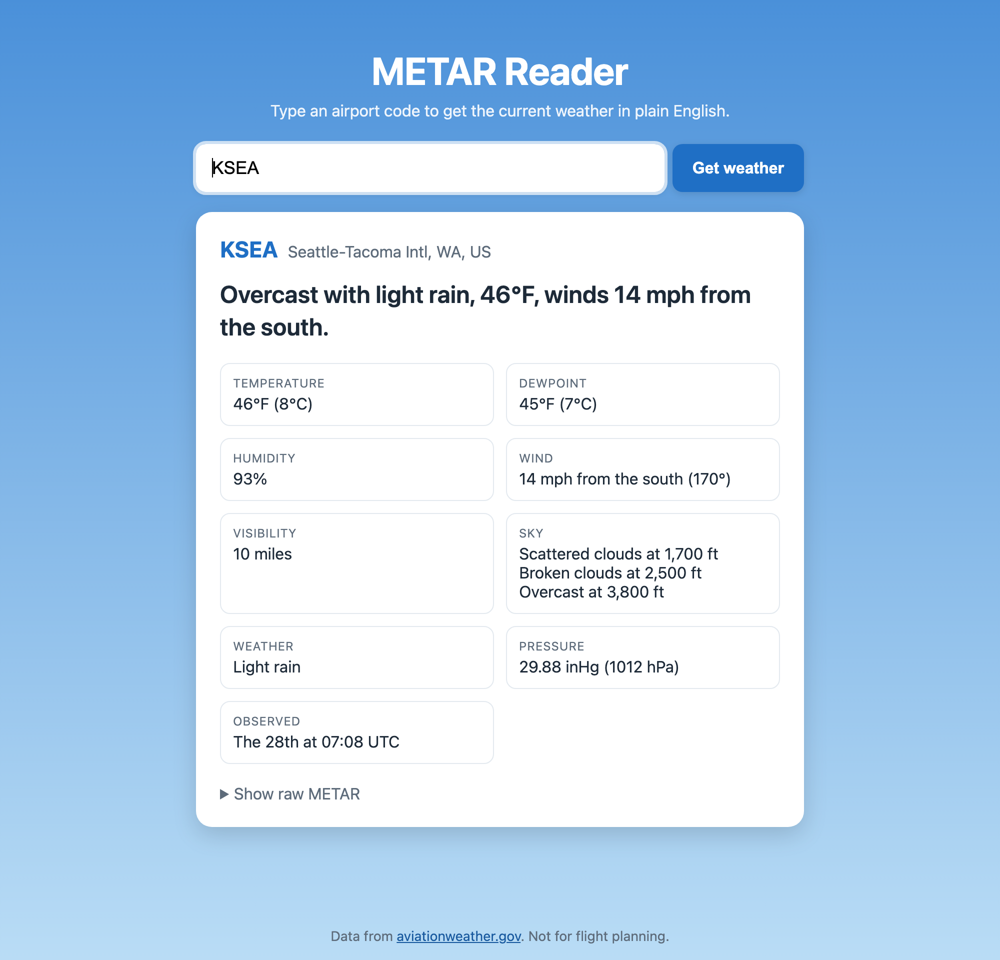
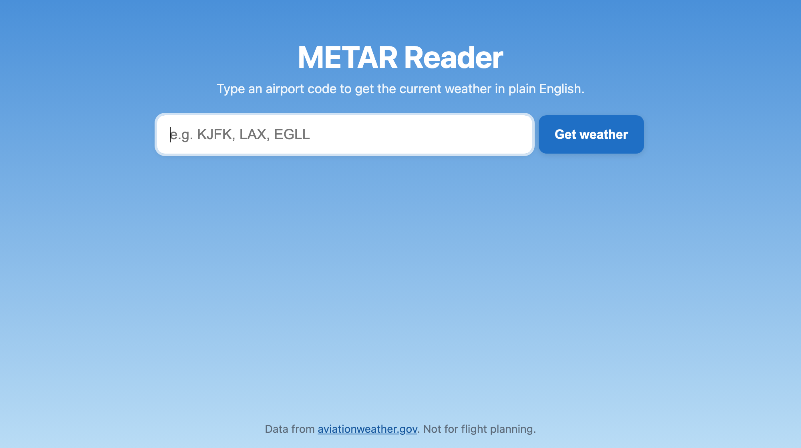
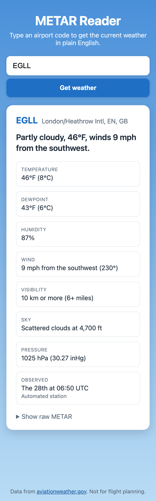
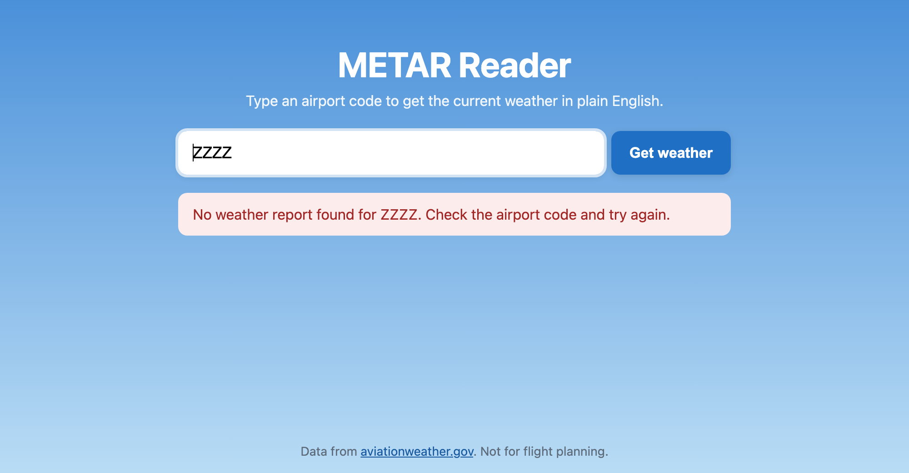

# METAR Reader

**Turn cryptic airport weather reports into plain English.**

METAR Reader is a small Flask web app. Type in an airport code and it fetches the latest METAR (the standard aviation weather report) from [aviationweather.gov](https://aviationweather.gov) and decodes it into something anyone can read.

Instead of this:

```text
METAR KSEA 280708Z 17012KT 10SM -RA SCT017 BKN025 OVC038 08/07 A2988
```

You get this:

> **Overcast with light rain, 46°F, winds 14 mph from the south.**



---

## Table of contents

- [Features](#features)
- [Screenshots](#screenshots)
- [Quick start](#quick-start)
- [Using the app](#using-the-app)
- [JSON API](#json-api)
- [How METAR decoding works](#how-metar-decoding-works)
- [Using the decoder in your own code](#using-the-decoder-in-your-own-code)
- [Project structure](#project-structure)
- [Running the tests](#running-the-tests)
- [Deployment](#deployment)
- [Limitations](#limitations)
- [Contributing](#contributing)
- [Acknowledgements](#acknowledgements)

---

## Features

- **Plain-English summary**: a single friendly sentence covering sky, temperature and wind.
- **Detailed breakdown**: temperature, dewpoint, humidity, wind (with gusts and direction changes), visibility, every cloud layer, weather like rain or fog, pressure, and observation time.
- **US-friendly units**: °F, mph and miles, with °C, hPa and metric values shown alongside.
- **Worldwide**: handles both US reports and international (metric) reports.
- **Forgiving input**: accepts lower case and 3-letter US codes (`jfk` becomes `KJFK`).
- **Friendly errors**: clear messages for invalid codes, unknown airports, or when the weather service is unreachable.
- **JSON API**: get the decoded report as JSON for use in other projects.
- **No API key needed**: uses the free, public aviationweather.gov service.
- **Mobile-friendly**: the page works well on phones.

---

## Screenshots

### Search page



### Decoded report

See the screenshot at the [top of this page](#metar-reader). The summary sentence is at the top of the card, with every detail from the report below it. Click **Show raw METAR** to see the original report.

### On a phone

The details switch to a single column on small screens. This international report (London Heathrow) shows metric visibility and pressure in hPa.



### Unknown airport

Invalid or unknown codes show a friendly message instead of an error page.



*Screenshots show live data from when they were taken. Your results will reflect the current weather.*

---

## Quick start

### Requirements

- Python 3.9 or newer
- An internet connection (the app fetches live weather data)

### Install and run

```bash
# 1. Clone the repository
git clone https://github.com/deepak-dev10/METAR-Reader.git
cd METAR-Reader

# 2. Create and activate a virtual environment
python3 -m venv .venv
source .venv/bin/activate        # On Windows: .venv\Scripts\activate

# 3. Install dependencies
pip install -r requirements.txt

# 4. Start the app
flask --app app run
```

Then open **<http://127.0.0.1:5000>** in your browser.

> **Tip:** `python app.py` also works and starts the server in debug mode, which reloads automatically when you edit the code.
>
> **macOS users:** port 5000 is often taken by AirPlay Receiver. If the page doesn't load, run on another port with `flask --app app run --port 5001`, or turn off AirPlay Receiver in System Settings → General → AirDrop & Handoff.

---

## Using the app

1. Enter an airport code in the search box.
2. Press **Get weather**.
3. Read the summary at the top of the card. The details below it show everything else in the report. Click **Show raw METAR** to see the original report.

### Which airport codes work?

| You type | What happens |
| --- | --- |
| `KJFK`, `EGLL`, `RJTT` | 4-letter ICAO codes are used as-is. Works for airports worldwide. |
| `JFK`, `lax`, `ord` | 3-letter codes are treated as US airports and a `K` is added (`JFK` becomes `KJFK`). |
| `1O2` | Codes containing digits are used as-is. |

> **Outside the US mainland, use the 4-letter ICAO code.** For example, London Heathrow is `EGLL`, not `LHR`. Alaska and Hawaii also use other prefixes (e.g. `PANC` for Anchorage, `PHNL` for Honolulu). If you only know an airport's 3-letter code, search for "*airport name* ICAO code".

### Example results

| Airport | Summary |
| --- | --- |
| `KJFK` (New York) | Partly cloudy, 45°F, winds 5 mph from the north-northeast. |
| `KSEA` (Seattle) | Overcast with light rain, 46°F, winds 14 mph from the south. |
| `EGLL` (London) | Clear skies, 46°F, winds 12 mph from the southwest. |
| `RJTT` (Tokyo) | Mostly clear, 66°F, winds 18 mph from the north. |

*Live results will vary with the current weather.*

---

## JSON API

### `GET /api/metar/<code>`

Returns the decoded report for an airport as JSON. Accepts the same codes as the search box.

```bash
curl http://127.0.0.1:5000/api/metar/KSEA
```

<details>
<summary>Example response</summary>

```json
{
  "station": "KSEA",
  "name": "Seattle-Tacoma Intl, WA, US",
  "report_type": "SPECI",
  "raw": "SPECI KSEA 280708Z 17012KT 10SM -RA SCT017 BKN025 OVC038 08/07 A2988 RMK AO2 RAB0656 P0000 T00830067 $",
  "summary": "Overcast with light rain, 46°F, winds 14 mph from the south.",
  "sky": "Overcast",
  "time": { "day": 28, "hour": 7, "minute": 8, "text": "The 28th at 07:08 UTC" },
  "auto": false,
  "corrected": false,
  "wind": {
    "direction_deg": 170,
    "direction_text": "south",
    "speed": 12,
    "unit": "KT",
    "speed_mph": 14,
    "gust_mph": null,
    "calm": false,
    "variable": false,
    "text": "14 mph from the south (170°)"
  },
  "wind_variation": null,
  "visibility": { "miles": 10.0, "text": "10 miles" },
  "cavok": false,
  "weather": ["light rain"],
  "clouds": [
    { "cover": "SCT", "height_ft": 1700, "type": null, "text": "Scattered clouds at 1,700 ft" },
    { "cover": "BKN", "height_ft": 2500, "type": null, "text": "Broken clouds at 2,500 ft" },
    { "cover": "OVC", "height_ft": 3800, "type": null, "text": "Overcast at 3,800 ft" }
  ],
  "sky_clear": false,
  "temperature": { "temp_c": 8, "temp_f": 46, "dew_c": 7, "dew_f": 45, "humidity": 93 },
  "pressure": { "inhg": 29.88, "hpa": 1012, "text": "29.88 inHg (1012 hPa)" },
  "unparsed": []
}
```

</details>

### Response fields

| Field | Type | Description |
| --- | --- | --- |
| `station` | string | ICAO airport code. |
| `name` | string | Full airport name from aviationweather.gov. |
| `report_type` | string | `METAR` (routine hourly report) or `SPECI` (special report issued when the weather changes significantly). |
| `raw` | string | The original METAR text. |
| `summary` | string | Friendly one-line summary. |
| `sky` | string or null | Overall sky description, e.g. "Partly cloudy". |
| `time` | object or null | Observation day and time in UTC. |
| `auto` | bool | `true` if the report came from an automated station. |
| `corrected` | bool | `true` if this report corrects an earlier one. |
| `wind` | object or null | Direction, speed (original unit and mph), gusts, and calm/variable flags. |
| `wind_variation` | string or null | Range the wind direction is shifting across, if reported. |
| `visibility` | object or null | Visibility in miles plus a readable description. |
| `cavok` | bool | `true` when the report says "ceiling and visibility OK". |
| `weather` | list of strings | Weather happening now, e.g. `["light rain", "mist"]`. |
| `clouds` | list of objects | Each cloud layer, lowest first: cover, height in feet, and cloud type. |
| `sky_clear` | bool | `true` if the report explicitly says there are no clouds. |
| `temperature` | object or null | Temperature and dewpoint in °C and °F, plus relative humidity (%). |
| `pressure` | object or null | Pressure in inHg and hPa. |
| `unparsed` | list of strings | Any parts of the report the decoder didn't recognise. |

### Errors

Errors return JSON in the form `{"error": "<message>"}`:

| Status | When |
| --- | --- |
| `400` | The code isn't 3 or 4 letters/digits. |
| `404` | No report was found for that airport. |
| `502` | aviationweather.gov couldn't be reached or sent an unexpected response. |

---

## How METAR decoding works

A METAR is a single line of space-separated groups. Each group describes one aspect of the weather. Here is the Seattle example from above, broken down:

| Group | Meaning | Decoded as |
| --- | --- | --- |
| `SPECI` | Report type | Special report (issued because the weather changed) |
| `KSEA` | Station | Seattle-Tacoma International |
| `280708Z` | Day and time (UTC) | The 28th at 07:08 UTC |
| `17012KT` | Wind direction and speed | From 170° (south) at 12 knots ≈ 14 mph |
| `10SM` | Visibility | 10 statute miles |
| `-RA` | Present weather | Light rain |
| `SCT017` | Cloud layer | Scattered clouds at 1,700 ft |
| `BKN025` | Cloud layer | Broken clouds at 2,500 ft |
| `OVC038` | Cloud layer | Overcast at 3,800 ft |
| `08/07` | Temperature / dewpoint | 8°C (46°F) / 7°C (45°F) |
| `A2988` | Altimeter (pressure) | 29.88 inHg |
| `RMK ...` | Remarks | Ignored (see [Limitations](#limitations)) |

### What the decoder understands

| Category | Examples | Notes |
| --- | --- | --- |
| Time | `280551Z` | Day of the month plus hours and minutes in UTC. |
| Wind | `02004KT`, `27015G28KT`, `VRB03KT`, `00000KT`, `240V300` | Knots, m/s or km/h, converted to mph. Handles gusts, variable and calm winds, and direction ranges. |
| Visibility | `10SM`, `1 1/2SM`, `M1/4SM`, `P6SM`, `9999`, `0800`, `CAVOK` | Statute miles (US) or metres (international). `M` = less than, `P` = more than. |
| Weather | `-RA`, `+TSRA`, `VCSH`, `FZFG`, `BR`, `+FC` | Intensity (light/heavy/nearby), descriptors (freezing, showers, thunderstorm…) and phenomena (rain, snow, fog, haze…). |
| Clouds | `FEW020`, `SCT250`, `BKN025CB`, `OVC008`, `VV001`, `CLR`, `SKC`, `NCD` | Cover amount, height in feet, and thunderstorm cloud types (`CB`, `TCU`). |
| Temperature | `07/05`, `M02/M05` | `M` means minus. Humidity is calculated from temperature and dewpoint. |
| Pressure | `A3043`, `Q1013` | inHg (US) or hPa (international), shown in both units. |
| Flags | `AUTO`, `COR` | Automated station, corrected report. |

### How the summary is built

The one-line summary combines:

1. **Sky**, based on the most-covered cloud layer:

   | Code | Meaning | Summary |
   | --- | --- | --- |
   | `CLR` / `SKC` / `NCD` / `CAVOK` | No clouds | Clear skies |
   | `FEW` | 1–2 eighths of the sky covered | Mostly clear |
   | `SCT` | 3–4 eighths | Partly cloudy |
   | `BKN` | 5–7 eighths | Mostly cloudy |
   | `OVC` | Fully covered | Overcast |
   | `VV` | Sky hidden (e.g. by fog) | Sky obscured |

2. **Weather**, if any, e.g. "with light rain".
3. **Temperature** in °F.
4. **Wind** speed and the direction it's blowing *from*, plus gusts.
5. **Visibility**, but only when it's under 3 miles.

---

## Using the decoder in your own code

The decoder in `metar_decoder.py` has no dependency on Flask or the network, so you can use it on its own:

```python
from metar_decoder import decode_metar

report = decode_metar("KORD 281853Z 09012KT 1 1/2SM -RA BR OVC008 04/03 A2988")

print(report["summary"])
# Overcast with light rain and mist, 39°F, winds 14 mph from the east, visibility 1 1/2 miles.

print(report["wind"]["text"])         # 14 mph from the east (90°)
print(report["temperature"]["humidity"])  # 93
```

Every function in the module has a docstring. Run `python -c "import metar_decoder; help(metar_decoder)"` to read them.

---

## Project structure

```text
METAR-Reader/
├── app.py                  # Flask routes and the aviationweather.gov API call
├── metar_decoder.py        # METAR parser and plain-English summary (no Flask needed)
├── requirements.txt        # Python dependencies
├── templates/
│   ├── base.html           # Page layout
│   └── index.html          # Search form and results card
├── static/
│   └── style.css           # Styles (responsive)
├── docs/
│   └── screenshots/        # Images used in this README
└── tests/
    ├── conftest.py             # Shared fixtures (test client, mock API)
    ├── test_app.py             # Flask app tests
    └── test_metar_decoder.py   # Decoder tests
```

### Request flow

```text
Browser ──GET /metar?code=jfk──▶ app.py
                                   │ normalize_code()  → "KJFK"
                                   │ fetch_metar()     → aviationweather.gov (JSON)
                                   │ decode_metar()    → metar_decoder.py
                                   ▼
Browser ◀──── rendered index.html with summary + details
```

---

## Running the tests

The project uses [pytest](https://docs.pytest.org/). Run the whole suite with:

```bash
pytest           # quick run
pytest -v        # list every test case
```

To see which lines of code the tests exercise:

```bash
pytest --cov=app --cov=metar_decoder --cov-branch --cov-report=term-missing
```

### How the tests are organised

| File | What it tests |
| --- | --- |
| `tests/test_metar_decoder.py` | The decoder, using hand-written mock METAR readings. Covers every group type (time, wind, visibility, weather, clouds, temperature, pressure), the helper functions, the summary rules, edge cases, and ten complete real-world style reports (blizzard, fog, thunderstorm, CAVOK, below freezing…) with their exact expected summaries. |
| `tests/test_app.py` | The Flask app: airport code normalisation, the API call, error handling (unknown airport, timeouts, bad responses), the HTML page and the JSON API. |
| `tests/conftest.py` | Shared fixtures: a Flask test client, `mock_api` for faking aviationweather.gov responses, and a guard that fails any test that tries to reach the real internet. |

Most tests are **parametrised tables**: one test function runs against many *mock METAR → expected meaning* rows, and pytest reports each row as its own test. Adding a new case is usually a one-line change:

```python
@pytest.mark.parametrize("group, expected", [
    ("-RA", "light rain"),
    ("+TSRA", "heavy thunderstorm with rain"),
    ("FZFG", "freezing fog"),     # ← add a row here
])
def test_weather(group, expected):
    ...
```

The app tests never call the live API, so the suite runs offline in under a second and always gets the same results.

---

## Deployment

`python app.py` and `flask run` use Flask's development server, which **is not suitable for production**. To deploy, use a production WSGI server such as [Gunicorn](https://gunicorn.org/):

```bash
pip install gunicorn
gunicorn app:app --bind 0.0.0.0:8000
```

The app is stateless and needs no database, configuration or API keys, so it runs on any platform that supports Python web apps (Render, Railway, Fly.io, Heroku, a VPS, etc.).

---

## Limitations

- **Remarks are not decoded.** Everything after `RMK` (such as precise temperatures or sea-level pressure) is skipped, because that section is less standardised.
- **Forecast trends are not decoded.** Groups like `TEMPO`, `BECMG` and `NOSIG` that predict upcoming changes are skipped.
- **Runway visual range** (e.g. `R04L/2000FT`) is recognised but not displayed.
- **The 3-letter shortcut is for US airports only.** It adds a `K`, which is right for the US mainland but not for Alaska, Hawaii or other countries.
- **Times are in UTC.** METARs don't include the month or year, and the app doesn't convert to the airport's local time.
- **Not for flight planning.** This app is for general interest only. Pilots should use official sources.

---

## Contributing

Contributions are welcome! To get started:

1. Fork the repository and create a branch for your change.
2. Set up the project as described in [Quick start](#quick-start).
3. Make your change and add or update tests in `tests/`.
4. Run `pytest` and make sure everything passes.
5. Open a pull request describing what you changed and why.

Ideas for improvements:

- Decode the remarks section (`RMK`)
- Show times in the airport's local time zone
- Add an option to switch between imperial and metric units
- Look up airports by name or by 3-letter IATA code worldwide
- Show the TAF (forecast) alongside the current report

If you find a METAR the app decodes incorrectly, please open an issue and include the raw METAR text. Groups the decoder doesn't recognise appear in the `unparsed` field of the JSON API.

---

## Acknowledgements

- Weather data from the [Aviation Weather Center](https://aviationweather.gov) (NOAA / National Weather Service) via its [public data API](https://aviationweather.gov/data/api/).
- Built with [Flask](https://flask.palletsprojects.com/) and [Requests](https://requests.readthedocs.io/).
